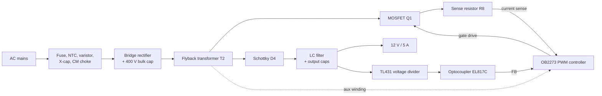

# 12V 5A (60 W) Isolated Flyback SMPS

An offline, isolated switch-mode power supply designed in **KiCad 9.0**. It converts AC mains into a regulated **12 V DC output at up to 5 A** using a flyback converter with secondary-side regulation (TL431 + optocoupler).

> ⚠️ **Mains voltage warning:** this circuit connects directly to AC mains and has lethal voltages (up to ~400 V DC) on the primary side. Only build or test it if you are experienced with mains-connected electronics.

## Specifications

| Parameter | Value |
|---|---|
| Output | 12 V DC, 5 A (60 W) |
| Topology | Isolated flyback |
| PWM controller | OB2273 (current-mode, SOT-23-6) |
| Power switch | SVF12N65F (650 V N-MOSFET) |
| Transformer | EFD30 core, custom wound |
| Output rectifier | MBRF30100 dual Schottky |
| Feedback | TL431 + EL817C optocoupler |
| Primary-secondary clearance | 6 mm (enforced by custom DRC rules) |
| PCB | 2-layer, 1.6 mm |

## Block diagram

## How it works

### 1. Input stage and rectification
Mains enters through terminal block **J1** and a **1 A fuse (F1)**. The **varistor (R1)** clamps surges, the **X-capacitor (C1, 100 nF / 275 VAC)** and the **common-mode choke (T1)** filter conducted noise, and the **NTC thermistor (R2)** limits the inrush current when the bulk capacitor charges. The **KBP410 bridge (BR1)** rectifies the AC and the **120 µF / 400 V capacitor (C2)** smooths it into a high-voltage DC rail (the `DCLINE` net, roughly 310–340 V DC at 230 V AC input).

### 2. Start-up and controller supply
When power is first applied, the OB2273 has no supply. **R3 and R4** (470 kΩ each, in series) trickle current from the DC rail into the VDD pin, charging **C5 (47 µF)** and **C6 (1 µF)**. Once VDD reaches the start-up threshold, the controller begins switching.

After start-up, the **auxiliary winding** on T2 (pins 4 and 6) takes over: diode **D2 (FR107)** and resistor **R9** rectify it to keep VDD alive without the wasteful start-up resistors. **D3 (24 V zener)** clamps VDD to protect the controller from overvoltage.

### 3. Switching and energy transfer (flyback action)
The OB2273 is a current-mode PWM controller. Its switching frequency is set by **R10** (100 kΩ) on the RI pin. It drives the gate of **Q1 (SVF12N65F)** through gate resistor **R6 (10 Ω)**.

- **MOSFET ON:** current ramps up through the primary winding of T2 and energy is stored in the transformer core. The secondary diode is reverse-biased, so the output capacitors alone supply the load.
- **MOSFET OFF:** the transformer voltage reverses, the Schottky **D4 (MBRF30100)** conducts, and the stored energy is delivered to the secondary, charging the output capacitors and feeding the load.

The transformer provides **galvanic isolation** between the mains-side primary and the safe-voltage secondary.

### 4. Current sensing and protection
Primary current flows through **R8 (0.2 Ω)** to ground. The resulting voltage is fed to the SENSE pin through **R7 (100 Ω)** and **C4 (100 pF)**, which form a low-pass filter that suppresses the turn-on spike. The controller ends each cycle when the peak current reaches its limit, giving **cycle-by-cycle overcurrent protection**.

### 5. Snubber / clamp
When Q1 turns off, the transformer's leakage inductance causes a voltage spike on the drain. The **RCD clamp** formed by **D1 (FR207), R5 (33 kΩ) and C3 (3.3 nF / 630 V)** absorbs this energy, keeping the drain voltage within the MOSFET's 650 V rating.

### 6. Output filtering
The Schottky output is smoothed by **C10 (2200 µF) and C11 (1000 µF)**, then passed through the **3.3 µH inductor (L1)** and **C12 (470 µF)** to reduce high-frequency ripple. **R16 (470 Ω)** acts as a small preload, and **R17 with LED D5** gives a power-on indicator.

### 7. Voltage regulation (feedback loop)
The output voltage is regulated on the secondary side:

1. A resistor divider (**R13** from the output, **R14** and trimmer **R15** to ground) feeds a fraction of the output voltage to the reference pin of the **TL431 (U1)**. The output voltage is set by

   `Vout ≈ Vref × (1 + R13 / R_bottom)`, where Vref ≈ 2.5 V

   and the **trimmer R15 fine-tunes** the final output.
2. If the output rises above target, the TL431 conducts harder and increases the current through the **optocoupler LED (OP1)**. Resistors **R11 and R12** set the bias, and **C8 (100 nF)** provides loop compensation.
3. The optocoupler's transistor pulls the controller's **FB pin** down, filtered by **C7 (10 nF)**, which tells the OB2273 to deliver less energy per cycle. If the output falls, the opposite happens.

Because the optocoupler transmits the error signal by light, the feedback loop crosses the isolation barrier without any electrical connection.

### 8. Isolation and EMI
The primary ground (`GND-1`) and secondary ground (`GND-2`) are separate. The only deliberate bridge between them is the **Y-capacitor C9 (2.2 nF / 250 VAC)**, which provides a return path for common-mode noise. Custom KiCad design rules enforce a **6 mm clearance** between primary-side and secondary-side copper.

## Key components

| Ref | Part | Function |
|---|---|---|
| F1 | 1 A fuse | Overcurrent protection |
| R1 | Varistor B72207S0271K101 | Surge protection |
| R2 | NTC 5D-11 | Inrush current limiting |
| C1 | 100 nF / 275 VAC | X-capacitor (differential EMI filter) |
| T1 | UU9.8 common-mode choke | Common-mode EMI filter |
| BR1 | KBP410 | Bridge rectifier |
| C2 | 120 µF / 400 V | Bulk capacitor |
| IC1 | OB2273 | Current-mode PWM controller |
| Q1 | SVF12N65F | 650 V power MOSFET |
| R8 | 0.2 Ω | Primary current sense |
| D1, R5, C3 | FR207, 33 kΩ, 3.3 nF | RCD snubber / clamp |
| T2 | EFD30 (6+6) | Flyback transformer (isolation) |
| D4 | MBRF30100 | Secondary Schottky rectifier |
| C10, C11, C12, L1 | 2200 µF, 1000 µF, 470 µF, 3.3 µH | Output filter |
| U1 | TL431 | Voltage reference / error amplifier |
| OP1 | EL817C | Optocoupler (isolated feedback) |
| R15 | 1 kΩ trimmer | Output voltage adjustment |
| C9 | 2.2 nF / 250 VAC | Y-capacitor |

## Repository contents

| File / folder | Description |
|---|---|
| `SMPS_12V_5A.kicad_sch` | Schematic |
| `SMPS_12V_5A.kicad_pcb` | PCB layout |
| `SMPS_12V_5A.kicad_pro` | KiCad project file |
| `SMPS_12V_5A.kicad_dru` | Custom design rules (isolation clearance) |
| `libs/lcsc/` | Imported LCSC symbols, footprints and 3D models |
| `mysmps.pretty/` | Custom footprints (transformer, 400 V capacitor) |

Open `SMPS_12V_5A.kicad_pro` in KiCad 9.0 or newer to view the design.

## Status

- [x] Schematic
- [x] PCB layout
- [ ] Prototype built
- [ ] Full-load testing

## Author

**Dheeraj**
